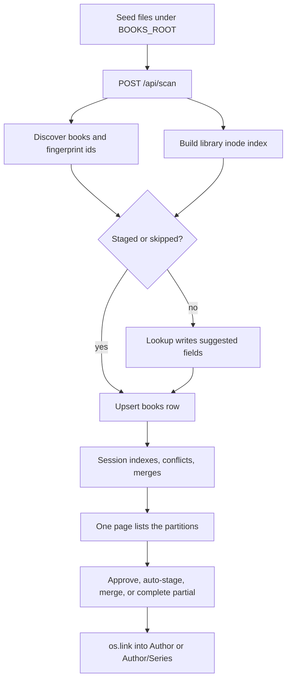

# System map (observed)

How a seed file becomes a library hardlink in the running process, and which modules own each step. Choices for a later shape are in `ARCHITECTURE-OPTIONS.md`. This page does not propose one.

Evidence is from the eight exploration reports. Path citations are the lines those reports name, plus spot-checks called out where a report left a call site unlabeled.

## Seed file to library hardlink

One FastAPI process serves whoever can open the port. Seeds are the tree at `BOOKS_ROOT`. The library is the tree at `AUDIOBOOKS_ROOT`. Book rows, scans, and the provider cache sit in SQLite at `{config root}/stager.db` (`01-product-contract.md`, `app/settings.py:13-16`, `app/settings.py:19-24`).

1. **Scan.** `POST /api/scan` starts one background scan, unless an auto-run is already active (`01-product-contract.md`, `app/api.py:785-807`). Discovery walks the seed tree into flat books (`01-product-contract.md`, `stager_core/discovery.py`).
2. **Identity.** Each book id is a 12-character SHA1 of the sorted per-file content fingerprints (`04-persistence-filesystem.md`, `stager_core/discovery.py:306-310`, `stager_core/fingerprint.py:63-67`).
3. **Library index.** The scan walks library audio files into `library_index` and `inode_index` (`04-persistence-filesystem.md`, `app/session.py:59-72`, `stager_core/target_index.py:84-156`). A seed file is staged when its inode is already in that index (`04-persistence-filesystem.md`, `stager_core/staging.py:206-243`).
4. **Metadata.** Books that are not already staged or skipped take one locked lookup: tags, title cleanup, provider passes, scoring, series votes, and optional library-vocabulary boost (`03-metadata-pipeline.md`, `stager_core/metadata/lookup.py:140-149`; `01-product-contract.md`, `app/scan.py:540-579`). The lookup writes `suggested_*`. It does not create hardlinks.
5. **Remember.** The scan upserts `books`, writes a `scans` row, and may write `lookup_decisions` and `api_cache` (`01-product-contract.md`, `app/scan.py:513+`). The process session keeps the indexes and the conflict and merge groups (`01-product-contract.md`, `app/session.py:220-238`).
6. **Review.** The browser is one page. It loads `GET /api/books?partitioned=true` and paints staging, partial, conflicts, and merges from that payload (`05-ui-workflows.md`, `static/app.js:4788-4795`).
7. **Hardlink.** Approve, auto-stage, merge, and complete-partial call `os.link` (`04-persistence-filesystem.md`, `stager_core/staging.py:426-427`). The folder is `Author/Title` when effective series is empty, and `Author/Series/{index} - {Title}` when series is present (`04-persistence-filesystem.md`, `stager_core/staging.py:300-332`). Unstage removes a library name only when `same_inode` is true (`04-persistence-filesystem.md`, `stager_core/staging.py:735-740`).

## Module map

| Piece | What it owns | Boundary observed |
| --- | --- | --- |
| `app/` (10 modules) | HTTP under `/api`, process startup, the holder, one SQLite connection, scan thread, auto thread, APScheduler, activity lock, in-memory session | Imports `stager_core`. Does not implement provider HTTP (`02-backend-boundaries.md`) |
| `stager_core/` (34 modules) | Discovery, fingerprints, path layout, hardlinks, conflicts, merges, metadata | No top-level `import app`, except lazy imports in `stager_core/library_cache.py:17` (`02-backend-boundaries.md`) |
| Holder | `ScanManager`, `AutoRunManager`, `conn`, `StagingSession`, scheduler tick (`02-backend-boundaries.md`, `app/api.py:130-138`). Wired on startup (`app/main.py:44-59`), cleared on shutdown (`app/main.py:67-73`) | One object per process |
| SQLite | WAL, `busy_timeout=10000`, `check_same_thread=False` (`02-backend-boundaries.md`, `app/db.py:496-507`). `DB_LOCK` is a process `RLock` (`app/db.py:24`). Every `connect` runs `SCHEMA` and `_migrate_schema` (`04-persistence-filesystem.md`, `app/db.py:300-441`) | One long-lived connection in `holder.conn`. `db_conn()` has no production caller (`02-backend-boundaries.md`) |
| Filesystem | Read seeds. `os.link` into the library. Inode-checked unlink on unstage. Empty-directory prune (`04-persistence-filesystem.md`) | Health does not test that seed and library share a mount (`04-persistence-filesystem.md`, `app/api.py:545-628`). README states the requirement (`README.md:28`) |
| Metadata | Tag read, cleanup, provider order, scoring, series, LVI, author oeuvre, `api_cache` (`03-metadata-pipeline.md`) | `provider_registry.py` is a status catalog. Search I/O stays in `providers.py` (`02-backend-boundaries.md`) |
| `static/` | One document at `/`, no client router, dialogs for detail, settings, confirm, and conflict (`05-ui-workflows.md`). `static/app.js` is 5951 lines | Book list request sends no `limit` or `offset` (`05-ui-workflows.md`, `static/app.js:4788-4795`) |

Sizes measured in the reports: `app/api.py` 2811, `app/db.py` 1451, `app/scan.py` 986, `stager_core/staging.py` 931, `stager_core/metadata/providers.py` 919 (`02-backend-boundaries.md`); `static/style.css` 2587, `static/index.html` 392 (`05-ui-workflows.md`).

## Session, lock, and one-at-a-time

After a finished scan the session keeps `library_index`, `inode_index`, LVI, and the conflict and merge groups (`04-persistence-filesystem.md`, `app/session.py:42-49`). Restart hydration inside 24 hours loads `library_targets` and stats inodes, and skips the library walk (`02-backend-boundaries.md`, `app/session.py:253-288`). `GET /api/session/status` reports `no_scan`, `stale_scan`, `fresh`, `scan_running`, or `auto_running` (`01-product-contract.md`, `app/api.py:667-737`). Stale means the last completed scan is older than 24 hours (`STALE_SCAN_HOURS` in `app/session.py:35`) or the in-memory session was not hydrated.

`POST /api/scan` returns 409 when an auto-run is active, and `ScanAlreadyRunning` when a scan thread is alive (`02-backend-boundaries.md`, `app/api.py:789-806`). `start_run` raises `AutoRunBlocked` when a scan thread is alive (`app/auto.py:113-115`). An auto-run starts that same scan thread from inside the auto workflow (`02-backend-boundaries.md`). Scheduled auto waits on the activity lock; a manual auto-run may bypass it (`02-backend-boundaries.md`, `app/auto.py:94-95`, `app/auto.py:121-122`).

`list_books` reads the full `books` table three times when it refreshes conflicts and merges (`08-scale.md`, `app/api.py:882`, `app/session.py:168-192`). That cost is the scale input for `ARCHITECTURE-OPTIONS.md`. It is not a second design.

## Unknowns

| Topic | Report |
| --- | --- |
| More than one Uvicorn worker in production | `02-backend-boundaries.md` unknowns. `app/main.py` does not set a worker count |
| Scheduler timezone and drift | `01-product-contract.md` unknowns |
| Typical `candidates_json` size, conflict-group counts at 50,000 books, peak RSS | `08-scale.md` unknowns |
| `st_ino` on platforms without stable inodes | `04-persistence-filesystem.md` unknowns |
| Clean-clone `pytest` and Docker health on an empty data directory | `07-oss-readiness.md` unknowns |

Spot-checks recorded on inventory rows, not restated here: `exclude.txt` has definitions and no callers; `GET /api/auto/review` has no `LIMIT`; library replace is called with author and title only; `mam_exact` has a scoring prior and no application emitter found under `*.py`.
